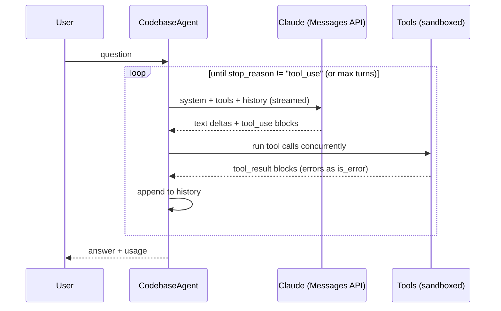

# claude-codebase-agent

[](https://github.com/tomziebro/claude-codebase-agent/actions/workflows/ci.yml)


A TypeScript CLI agent that uses Claude's tool use to explore a codebase and answer questions about it. Point it at a repository, ask how something works, and it searches, reads and cites the code it used to answer.

```console
$ codebase-agent -r ../payments-api "How are failed webhooks retried?"

› search_code {"pattern":"retry","glob":"*.ts"}
› read_file {"path":"src/webhooks/dispatcher.ts","start_line":40,"end_line":95}

Failed deliveries are retried with exponential backoff, up to 5 attempts
(src/webhooks/dispatcher.ts:52-61) ...

2 turn(s) · 2 tool call(s) · 6,812 in / 412 out · 4,960 cached
```

## Features

- **Agentic tool loop.** Claude decides what to look at using three read-only tools: `list_files`, `search_code` (regex + glob) and `read_file` (line ranges). Independent tool calls in one turn run concurrently.
- **Streaming.** Answers print token by token over Server-Sent Events, with tool calls shown as they happen.
- **Sandboxed file access.** Every path the model supplies is resolved against the repository root. `..`, absolute paths and symlinks pointing outside the root are rejected, and `.git`, `node_modules` and build output are excluded.
- **Prompt caching.** Tool definitions, the system prompt and the growing conversation are marked as cache breakpoints, so each turn re-reads most of its input from cache.
- **Resilient client.** Retries rate-limit (429), overload (529) and 5xx responses with exponential backoff and jitter, and honors `retry-after`.
- **Interactive mode.** Follow-up questions keep their context; `/reset` clears it.
- **Zero runtime dependencies.** The Messages API client, SSE parser and glob matcher are written from scratch on top of Node's built-in `fetch`.

## Quick start

Requires Node.js 20+ and an [Anthropic API key](https://console.anthropic.com).

```bash
git clone https://github.com/tomziebro/claude-codebase-agent.git
cd claude-codebase-agent
npm install
npm run build
npm link            # puts `codebase-agent` on your PATH

export ANTHROPIC_API_KEY=sk-ant-...
codebase-agent -r /path/to/repo "Where is authentication handled?"
```

Or run from source without building: `npm run dev -- -r /path/to/repo "your question"`.

## Usage

```
codebase-agent [options] [question]

  -r, --root <dir>       Repository to explore (default: current directory)
  -m, --model <id>       Claude model (default: $CLAUDE_MODEL or claude-sonnet-5-5)
      --max-turns <n>    Tool-use round trips per question (default: 25)
  -q, --quiet            Hide tool calls and the usage summary
  -h, --help             Show help
```

Run without a question to start an interactive session.

### As a library

```ts
import { CodebaseAgent, HttpMessagesClient, Workspace } from "claude-codebase-agent";

const agent = new CodebaseAgent({
  client: new HttpMessagesClient({ apiKey: process.env.ANTHROPIC_API_KEY! }),
  workspace: await Workspace.open("./my-repo"),
  model: "claude-sonnet-5-5",
  events: { onToolCall: (call) => console.log("tool:", call.name) },
});

const { answer, usage } = await agent.ask("What does the build pipeline do?");
```

## How it works



```
src/
├── cli.ts                 argument parsing, REPL, terminal output
├── agent.ts               the tool-use loop, history, prompt-cache breakpoints
├── prompt.ts              system prompt
├── anthropic/
│   ├── client.ts          HTTP client, retries, stream accumulation
│   ├── sse.ts             Server-Sent Events parser
│   └── types.ts           typed subset of the Messages API
└── tools/
    ├── workspace.ts       path sandbox and directory walker
    ├── listFiles.ts
    ├── readFile.ts
    ├── searchCode.ts      regex search and glob matching
    └── index.ts           registry and error handling
```

## Design notes

**Tool errors go back to the model, not up the stack.** Bad input, missing files and sandbox violations come back as `tool_result` blocks with `is_error: true`. Claude reads the message and corrects itself (a wrong path, an invalid regex) instead of the whole run failing.

**Tools are shaped to keep context small.** `search_code` returns `path:line: text` so the model can find what matters before reading. `read_file` returns numbered lines in pages with a hint for the next range, and every result is capped. The system prompt asks for citations in the same `path:line` form the tools produce.

**The model client is an interface.** `CodebaseAgent` depends on a one-method `MessagesClient`, so tests drive the full loop with scripted responses and no network, and the HTTP client is tested separately with a fake `fetch`.

**Repository content is untrusted.** Tools are read-only, and the system prompt tells the model to treat file contents as data, so instructions planted in a repository can't redirect the agent.

## Development

```bash
npm install
npm run typecheck
npm test            # node:test via tsx, no API key needed
npm run build
```

The test suite covers SSE parsing across chunk boundaries (including split UTF-8), stream accumulation of text and tool input deltas, retry behavior, every tool, path-traversal and symlink escapes, glob matching, and the agent loop end to end with a scripted client.

## License

[MIT](LICENSE)
